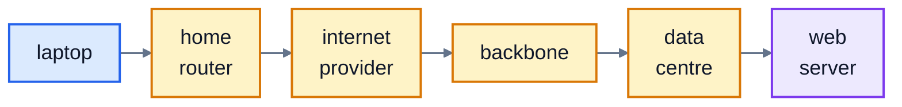
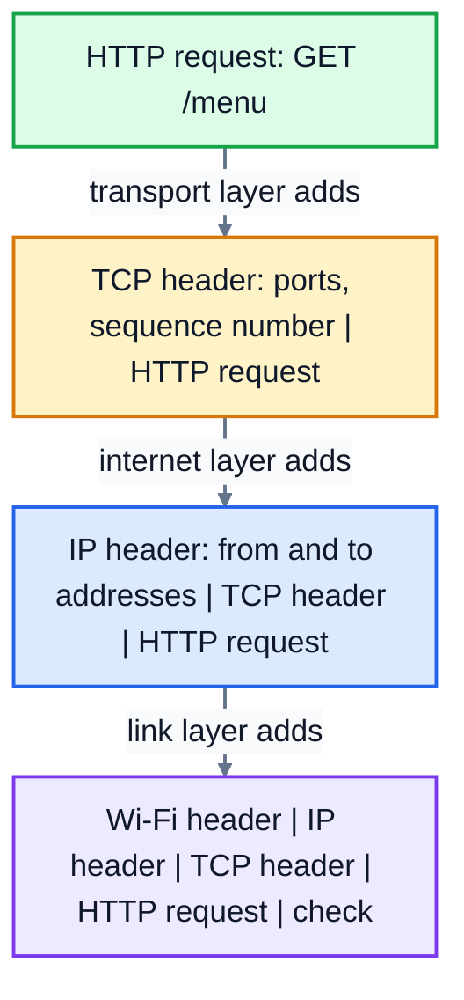

# 1. How the internet works

The internet is a network of networks. Your home network, your phone company's network, a university's network and the network inside a data centre are all separate, owned by different people. They agree to pass each other's traffic along, using the same rules. Those rules are called **protocols**, and this course is mostly about them.

## Clients and servers

Most of what you do online is a conversation between two programs:

- A **client** asks for something. Your web browser is a client.
- A **server** answers. A web server is a program that waits for requests and sends back pages.

"Server" can mean the program or the computer it runs on. One computer can run many servers, and your laptop can be a server too: in lesson 6 you'll write one.

## Packets

When a server sends you a web page, it doesn't send it all at once. The data is cut into small **packets**, usually up to about 1,500 bytes each, and each packet travels on its own. A typical web page is hundreds of packets.

Each packet carries a label saying where it's from and where it's going (the IP addresses, lesson 2), a little like an envelope. It's a bit like sending a long letter as a stack of postcards:

- **Many conversations share the same cables.** Your packets are mixed in with everyone else's, so nobody has to wait for a whole film to finish downloading before anyone else can use the line.
- **Packets can take different routes.** If one link is busy or broken, the next packet can go another way.
- **Packets can arrive out of order, arrive twice, or not arrive at all.** The receiver has to sort that out. That's the job of TCP (lesson 5).

## Routers

A **router** is a device that passes packets between networks. Your home Wi-Fi box is a router: it connects your home network to your internet provider's. Each router looks at a packet's destination address, picks the next router that's closer to it, and passes it on. Each step is called a **hop**. No router knows the whole route; each one only knows which way to send things next.



A packet to a website might pass through 10 to 20 routers. The `traceroute` command (lesson 9) tries to list them. Here's a real run on a computer inside a virtual machine:

```
$ traceroute -n -q 1 -w 1 -m 12 example.com
traceroute to example.com (172.66.147.243), 12 hops max, 60 byte packets
 1  10.0.2.2  0.856 ms
 2  *
 3  *
 4  *
 ...
```

The first hop answered: that's the virtual machine's own router. Every hop after that shows `*`, meaning no reply. That's common. `traceroute` relies on routers sending back a small error message, and many networks switch that off. The packets still got through: the website loaded fine. It's a useful lesson in itself: a tool showing `*` doesn't always mean something is broken.

## Layers

Getting a web page involves many jobs: finding the address, getting packets across each link, putting them in order, and understanding the page. Each job is handled by a separate protocol, stacked in **layers**. Each layer uses the one below it and doesn't need to know how it works.

| Layer | Its job | Examples | Lessons |
|---|---|---|---|
| **Application** | what the programs say to each other | HTTP, HTTPS, DNS, email (SMTP) | 4, 7, 8 |
| **Transport** | getting data between two programs: reliably (TCP) or quickly (UDP) | TCP, UDP | 5, 6 |
| **Internet** | getting packets between any two computers, across many networks | IP | 2, 3 |
| **Link** | getting a packet across one physical link | Ethernet, Wi-Fi | |

When you send something, each layer wraps the data from the layer above with its own label, like putting a letter in an envelope, then that envelope in a mailbag. This is called **encapsulation**. The receiver unwraps them in reverse.



The four layers above are the **TCP/IP model**, which is how the internet is actually built. You'll also hear about the **OSI model**, which splits the same jobs into seven layers. People use its numbers as shorthand: a "layer 3" device is a router (IP), "layer 4" is TCP and UDP, and "layer 7" is the application, like HTTP. You don't need to memorise it, but you'll recognise the numbers when they come up.

## What happens when you visit a website

Here's the whole journey, with the lessons that explain each step:

1. You type `https://example.com`. Your computer needs the server's IP address, so it asks a **DNS** server: "what's the address for example.com?" (lesson 4)
2. It gets back an address like `172.66.147.243` (lesson 2), and works out that it's not on the local network, so the packets must go to the router (lesson 3).
3. It opens a **TCP** connection to that address on **port** 443 (lessons 5 and 6).
4. It sets up **TLS** encryption and checks the site's certificate (lesson 8).
5. It sends an **HTTP** request, `GET /`, and gets back a response with the page (lesson 7).
6. The page mentions images and styles, so the browser requests those too, often over the same connection.

## Exercise: packets

In real networks, splitting data into packets and putting it back together happens in TCP, which you'll look at properly in lesson 5. Here's a simpler version to start with.

Open [exercise.py](./exercise.py) and write:

| Function | What it does |
|---|---|
| `split_message(message, size)` | splits the text into packets of at most `size` characters, returning a list of `(number, chunk)` pairs, numbered from 0 |
| `missing_packets(packets, total)` | given the packets that arrived and how many were sent, returns a sorted list of the numbers that are missing |
| `reassemble(packets, total)` | puts packets that arrived in any order, possibly with duplicates, back into the message. Raises `ValueError` if any are missing. |

Run the tests from the lesson folder:

```bash
cd 01-how-the-internet-works
python3 -m unittest -v
```

Running `python3 exercise.py` splits a message, then reassembles it from packets that arrived out of order, with one duplicate. When everything works, it prints:

```
[(0, 'Your ord'), (1, 'er has s'), (2, 'hipped!')]
Your order has shipped!
[1]
```

<details>
<summary>Hints</summary>

- `split_message`: loop with `range(0, len(message), size)` to get each start position, and slice `message[start:start + size]`.
- `missing_packets`: put the numbers that arrived in a set, then check each number from 0 to `total - 1`.
- `reassemble`: call `missing_packets` first and raise if anything's missing. Then store the chunks in a dictionary by number (a duplicate just overwrites itself), and join them in order from 0 to `total - 1`.

</details>

The full answer is in [solutions/01-how-the-internet-works.py](../solutions/01-how-the-internet-works.py).

## Recap

- The internet is many networks passing each other's traffic, using shared rules called protocols.
- Data travels in **packets**, which can take different routes and arrive out of order, twice, or not at all.
- **Routers** pass packets from network to network, one hop at a time.
- Protocols are stacked in **layers**: application (HTTP, DNS), transport (TCP, UDP), internet (IP) and link (Ethernet, Wi-Fi).

Next: [2. IP addresses](../02-ip-addresses/)
