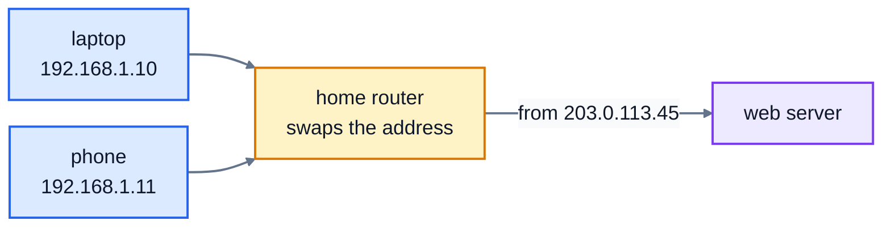

# 2. IP addresses

Every device on a network needs an address, so packets know where to go. On the internet that's an **IP address** (IP stands for Internet Protocol). This lesson covers what the numbers mean, why your laptop's address starts with 192.168 at home, and why the world is slowly moving to a much longer kind of address.

## IPv4 addresses

The classic kind is an **IPv4** address, written as four numbers separated by dots:

```
192.168.1.10
```

Each of the four numbers is one **byte**: 8 bits, so it can be anything from 0 to 255. An IPv4 address is really one 32-bit number, written in four parts to make it easier for people to read:

| Part | 192 | 168 | 1 | 10 |
|---|---|---|---|---|
| Binary | `11000000` | `10101000` | `00000001` | `00001010` |

All together, `11000000101010000000000100001010` in binary is 3,232,235,786. Computers work with that single number; the dots are for us. You'll need the binary view in lesson 3, because subnets are all about the bits.

To turn the four parts into one number, treat them like digits in base 256: `((192 × 256 + 168) × 256 + 1) × 256 + 10`. To go back, take the number apart 8 bits at a time.

32 bits give about 4.3 billion possible addresses. That sounded like plenty in 1981. It isn't.

## Special ranges

Some ranges of addresses are set aside for particular uses:

| Range | Name | Used for |
|---|---|---|
| `127.0.0.0` to `127.255.255.255` | **loopback** | your own computer. `127.0.0.1` always means "this machine", and packets sent to it never leave it. |
| `10.0.0.0` to `10.255.255.255` | **private** | home, office and cloud networks |
| `172.16.0.0` to `172.31.255.255` | **private** | the same |
| `192.168.0.0` to `192.168.255.255` | **private** | the same; most home routers use this one |
| `169.254.0.0` to `169.254.255.255` | **link-local** | a device picks one of these for itself when it can't get an address from the network. Seeing one usually means something's wrong. |
| `192.0.2.x`, `198.51.100.x`, `203.0.113.x` | **documentation** | examples in books and courses, like this one. They're never used on the real internet. |
| everything else (nearly) | **public** | addresses that are reachable across the internet |

Note the odd one: the private block in the middle is `172.16` to `172.31`, not all of `172`. So `172.20.5.9` is private, but `172.32.0.1` is public.

You can see your own computer's addresses with `ip addr` on Linux, `ifconfig` on macOS, or `ipconfig` on Windows. Here's the loopback one:

```
$ ip -br addr show lo
lo               UNKNOWN        127.0.0.1/8 ::1/128
```

## Private addresses and NAT

There are far more devices in the world than IPv4 addresses, so most of them don't have a public address at all. Your home network uses private addresses, like `192.168.1.10` for your laptop and `192.168.1.11` for your phone. Millions of other homes use exactly the same numbers, and that's fine, because private addresses are never used on the internet itself.

Your home router has **one** public address from your internet provider. When your laptop sends a packet out, the router swaps the private "from" address for its public one, and remembers the swap. When the reply comes back, it swaps it back and passes it to your laptop. This is **NAT**, network address translation.



To the web server, every device in your home looks like the same address. NAT is the main reason IPv4 has lasted this long. A side effect is that devices behind NAT can't easily be reached from outside, unless the router is told to forward traffic to them.

## IPv6

The long-term fix is **IPv6**, which uses 128-bit addresses, written as eight groups of four hexadecimal digits:

```
2001:0db8:0000:0000:0000:ff00:0042:8329
```

Leading zeros in each group can be dropped, and one run of all-zero groups can be replaced by `::`, so that's usually written `2001:db8::ff00:42:8329`. The loopback address is `::1`. `2001:db8::` addresses are for documentation, like `192.0.2.x`.

128 bits is about 340 trillion trillion trillion addresses: enough for every device to have its own public address, with no NAT. Most phones and many home connections already use IPv6, alongside IPv4. This course concentrates on IPv4, because it's still everywhere and its addresses are easier to work with by hand, but the ideas are the same.

## Addresses in Python

For real programs, Python's `ipaddress` module does all of this for you:

```python
>>> import ipaddress
>>> address = ipaddress.ip_address("192.168.1.10")
>>> address.is_private
True
>>> int(address)
3232235786
```

In the exercise you'll write these yourself, without it, so you understand what's going on underneath. The tests then check your answers against the `ipaddress` module on thousands of random addresses.

## Exercise: working with IPv4 addresses

Open [exercise.py](./exercise.py) and write these functions. Don't import `ipaddress`.

| Function | What it does |
|---|---|
| `is_valid_ipv4(text)` | `True` if `text` is four numbers from 0 to 255 separated by dots. Leading zeros like `01` aren't allowed, because some programs read them as octal (base 8). |
| `to_int(address)` | `'192.168.1.10'` gives `3232235786` |
| `from_int(number)` | the reverse: `3232235786` gives `'192.168.1.10'` |
| `to_binary(address)` | `'192.168.1.10'` gives `'11000000.10101000.00000001.00001010'`, with each part padded to 8 digits |
| `address_type(address)` | `'loopback'`, `'private'`, `'link-local'` or `'public'`, using the table above (count the documentation ranges as public) |

Run the tests from the lesson folder:

```bash
cd 02-ip-addresses
python3 -m unittest -v
```

Running `python3 exercise.py` tries each function. When everything works, it prints:

```
192.168.1.10 True
256.1.1.1 False
10.0.0.01 False
8.8.8.8 True
11000000.10101000.00000001.00001010
3232235786 192.168.1.10
127.0.0.1 loopback
172.20.5.9 private
172.32.0.1 public
169.254.10.3 link-local
8.8.8.8 public
```

(`8.8.8.8` is a real public address: Google's public DNS service.)

<details>
<summary>Hints</summary>

- `is_valid_ipv4`: `text.split(".")` must give exactly 4 parts. Each must be all digits (`part.isdigit()`, which is also `False` for an empty string), at most 255, and not start with `0` unless it's just `"0"`.
- `to_int`: start at 0; for each part, `number = number * 256 + int(part)`.
- `from_int`: shift right by 24, 16, 8 and 0 bits, and keep the lowest 8 bits each time: `(number >> shift) & 255`.
- `to_binary`: `format(10, "08b")` gives `'00001010'`.
- `address_type`: you only need the first two parts. Convert them to `int`s and compare.

</details>

The full answer is in [solutions/02-ip-addresses.py](../solutions/02-ip-addresses.py).

## Recap

- An IPv4 address is a 32-bit number, written as four bytes: `192.168.1.10`.
- `127.0.0.1` is your own computer. `10.x`, `172.16.x` to `172.31.x` and `192.168.x` are private.
- NAT lets many private devices share one public address.
- IPv6 addresses are 128 bits, written in hexadecimal, like `2001:db8::1`. `::1` is loopback.

Next: [3. Subnets and CIDR](../03-subnets-and-cidr/)
