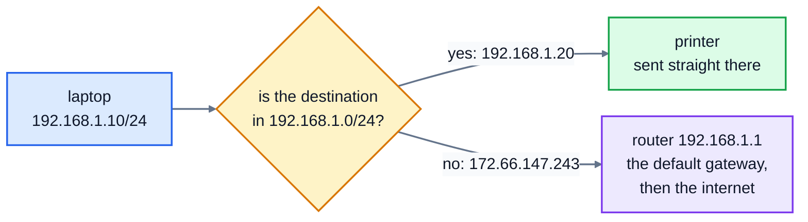

# 3. Subnets and CIDR

Your laptop's address is `192.168.1.10`. Your printer is `192.168.1.20`. Your laptop can send packets straight to the printer, but to reach `172.66.147.243` it has to go through the router. How does it know which is which? Every network is a **subnet**: a block of addresses that share the same beginning. This lesson is about how those blocks are described and worked out.

## Network part and host part

An IP address is split into two parts:

- the **network part**, at the start, which is the same for every device on the same network
- the **host part**, at the end, which is different for each device

Where the split falls is given by the **prefix length**, written after a slash. In `192.168.1.10/24`, the first 24 bits are the network part, and the last 8 bits are the host part.

| | 192 | 168 | 1 | 10 |
|---|---|---|---|---|
| bits | `11000000` | `10101000` | `00000001` | `00001010` |
| part | network | network | network | **host** |

So `192.168.1.0/24` means "every address from `192.168.1.0` to `192.168.1.255`". This way of writing a block, address then slash then prefix length, is called **CIDR notation** (Classless Inter-Domain Routing, say "cider").

## Subnet masks

The same split is often written as a **subnet mask**: a number whose bits are 1 for the network part and 0 for the host part. For `/24`, that's 24 ones then 8 zeros:

```
11111111.11111111.11111111.00000000  =  255.255.255.0
```

So `/24` and mask `255.255.255.0` mean the same thing. You'll see masks in older settings screens, and on Windows in `ipconfig`.

| Prefix | Mask | Addresses in the block | Usable by devices |
|---|---|---|---|
| `/8` | `255.0.0.0` | 16,777,216 | 16,777,214 |
| `/16` | `255.255.0.0` | 65,536 | 65,534 |
| `/22` | `255.255.252.0` | 1,024 | 1,022 |
| `/24` | `255.255.255.0` | 256 | 254 |
| `/26` | `255.255.255.192` | 64 | 62 |
| `/30` | `255.255.255.252` | 4 | 2 |
| `/32` | `255.255.255.255` | 1 | 1 (a single address) |

Each extra bit in the prefix halves the size of the block.

## Network and broadcast addresses

Two addresses in each block are special:

- The first, with the host bits all 0, is the **network address**: the name of the block itself. For `192.168.1.0/24`, it's `192.168.1.0`.
- The last, with the host bits all 1, is the **broadcast address**, which means "every device on this network". For `/24`, it's `192.168.1.255`.

Neither can be given to a device, which is why a `/24` has 254 usable addresses, not 256. (Two tiny exceptions: a `/31` is used for a link between exactly two routers, and both its addresses are usable; and a `/32` is one single address.)

Working them out is bit arithmetic:

- **network address** = address AND mask (keeps the network bits, clears the host bits)
- **broadcast address** = address OR (NOT mask) (keeps the network bits, sets the host bits)

Try it with `192.168.1.130/25`. A `/25` mask is `255.255.255.128`, so only the last byte is interesting:

| | Last byte in binary | Decimal |
|---|---|---|
| address | `1 0000010` | 130 |
| mask | `1 0000000` | 128 |
| AND: network | `1 0000000` | 128 |
| OR with inverted mask: broadcast | `1 1111111` | 255 |

So `192.168.1.130/25` is in the block from `192.168.1.128` to `192.168.1.255`. In Python, `&` is AND, `|` is OR and `^` is XOR, and they work on whole numbers, which is why lesson 2's `to_int` is so useful.

## Local or not?

Now the question from the start. When your laptop wants to send a packet, it checks: is the destination in my own subnet?

- **Yes**: send it straight there.
- **No**: send it to the **default gateway**, which is the router, and let it deal with it.

For a laptop at `192.168.1.10/24`:



Two addresses are in the same subnet if they're equal once you AND both with the mask. Here's the real routing table on a Linux machine, from `ip route`:

```
$ ip route
default via 10.0.2.2 dev eth0 proto dhcp src 10.0.2.15 metric 100
10.0.2.0/24 dev eth0 proto kernel scope link src 10.0.2.15 metric 100
```

Read it from the bottom: anything in `10.0.2.0/24` goes straight out of the network card `eth0` (this machine is `10.0.2.15`); everything else, the `default`, goes via the router at `10.0.2.2`. If the subnet is set up wrong, you get a classic fault: some nearby devices can't be reached, while the internet works fine, or the other way round.

## Splitting a network

Subnets are also used to divide up address space. A company with `10.0.0.0/16` (65,536 addresses) might give each office a `/24`. A cloud network might split `192.168.1.0/24` into four `/26`s, one for web servers, one for databases and so on:

| Subnet | Addresses | Usable range |
|---|---|---|
| `192.168.1.0/26` | 192.168.1.0 to .63 | .1 to .62 |
| `192.168.1.64/26` | 192.168.1.64 to .127 | .65 to .126 |
| `192.168.1.128/26` | 192.168.1.128 to .191 | .129 to .190 |
| `192.168.1.192/26` | 192.168.1.192 to .255 | .193 to .254 |

Separate subnets can then have separate rules, like "only the web servers can talk to the databases".

## Exercise: a subnet calculator

Open [exercise.py](./exercise.py). `to_int` and `from_int` from lesson 2 are written for you, and so is `mask_int(prefix)`, which gives a mask as a 32-bit number: `mask_int(24)` is `0xFFFFFF00`. Write these, without the `ipaddress` module:

| Function | What it does |
|---|---|
| `prefix_to_mask(prefix)` | `24` gives `'255.255.255.0'` |
| `mask_to_prefix(mask)` | `'255.255.252.0'` gives `22` |
| `network_address(cidr)` | `'192.168.1.130/25'` gives `'192.168.1.128'` |
| `broadcast_address(cidr)` | `'192.168.1.130/25'` gives `'192.168.1.255'` |
| `usable_hosts(prefix)` | `24` gives `254`. A `/31` gives 2 and a `/32` gives 1. |
| `same_network(first, second, prefix)` | `True` if the two addresses are in the same network of that size |

Run the tests from the lesson folder:

```bash
cd 03-subnets-and-cidr
python3 -m unittest -v
```

The tests compare your answers with Python's `ipaddress` module for thousands of random addresses and every prefix from 0 to 32.

Running `python3 exercise.py` tries each function. When everything works, it prints:

```
255.255.255.0 255.255.240.0 22
192.168.1.128 192.168.1.255
254 62 2
True False
```

<details>
<summary>Hints</summary>

- `prefix_to_mask` is `from_int(mask_int(prefix))`.
- `mask_to_prefix`: count the 1 bits: `bin(to_int(mask)).count("1")`.
- `network_address`: split the text at `/`, then `to_int(address) & mask_int(prefix)`.
- `broadcast_address`: the host bits are `0xFFFFFFFF ^ mask_int(prefix)`; OR them into the address with `|`.
- `usable_hosts`: `2 ** (32 - prefix) - 2`, with the two special cases first.
- `same_network`: AND both addresses with the mask and compare.

</details>

The full answer is in [solutions/03-subnets-and-cidr.py](../solutions/03-subnets-and-cidr.py).

## Recap

- A prefix length like `/24` splits an address into a network part and a host part. A mask like `255.255.255.0` says the same thing.
- The first address in a block is the network address; the last is the broadcast address. A `/24` has 254 usable addresses.
- network = address AND mask. Two addresses are on the same network if they match after ANDing with the mask.
- Destinations in your subnet are reached directly; everything else goes to the default gateway.

Next: [4. DNS](../04-dns/)
