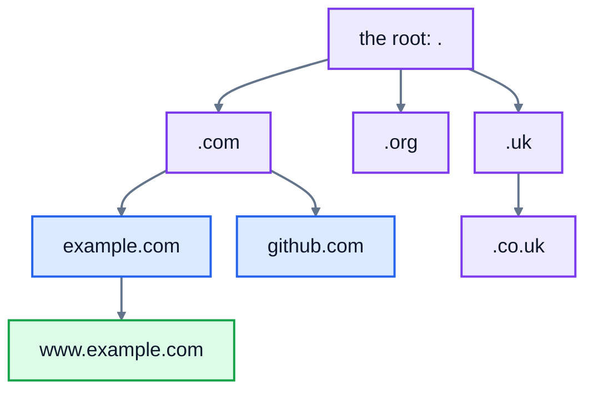
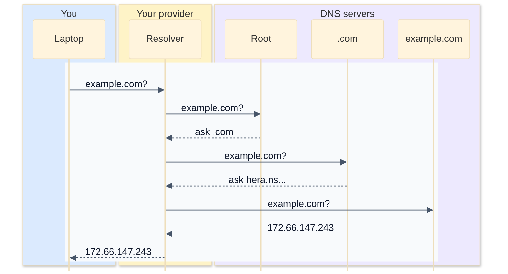

# 4. DNS

Computers find each other by IP address, but people remember names like `example.com`. The **Domain Name System** (DNS) is the internet's directory: it turns names into addresses. Almost every connection you make starts with a DNS lookup, so when DNS breaks, everything seems broken. There's an old joke among network engineers: "It's always DNS."

## Looking up a name

The `dig` command asks DNS a question and shows the answer. Here's a real lookup of `example.com`:

```
$ dig @1.1.1.1 example.com
...
;; QUESTION SECTION:
;example.com.			IN	A

;; ANSWER SECTION:
example.com.		52	IN	A	172.66.147.243
example.com.		52	IN	A	104.20.23.154

;; Query time: 23 msec
;; SERVER: 1.1.1.1#53(1.1.1.1) (UDP)
```

- The **question**: "what are the `A` records for example.com?" An `A` record is an IPv4 address.
- The **answer**: two addresses. Big sites often have several, for speed and in case one fails. Your computer picks one.
- `52` is the **TTL** (time to live), in seconds: how long this answer may be cached before asking again.
- `@1.1.1.1` asked a particular DNS server (Cloudflare's public one). Without it, `dig` asks whichever one your computer is set up to use. DNS queries usually go over UDP, to port 53.

On Windows, and on most systems, `nslookup example.com` does a similar job.

## Record types

DNS stores more than addresses. Each piece of information is a **record** with a type:

| Type | Holds | Real example |
|---|---|---|
| `A` | an IPv4 address | `example.com. 52 IN A 172.66.147.243` |
| `AAAA` | an IPv6 address | `example.com. 300 IN AAAA 2606:4700:10::6814:179a` |
| `CNAME` | "this name is another name for..." | `www.github.com. 3600 IN CNAME github.com.` |
| `MX` | where email for the domain goes, with a priority | `example.com. 300 IN MX 0 .` (`.` means "this domain takes no email") |
| `NS` | which servers are in charge of the domain | `example.com. 71756 IN NS hera.ns.cloudflare.com.` |
| `TXT` | any text; used to prove you own a domain, and for email security settings | |

The dot at the end of names like `github.com.` isn't a typo. It stands for the root of the whole system, and it's normally left off.

A **CNAME** is an alias. When you look up `www.github.com`, DNS says "that's really `github.com`", and then gives you `github.com`'s address:

```
$ dig @1.1.1.1 www.github.com +noall +answer
www.github.com.		3600	IN	CNAME	github.com.
github.com.		60	IN	A	20.207.73.82
```

CNAMEs are handy when a service is hosted by someone else. A bakery's `shop.rosiesbakery.example` might be a CNAME for its online shop provider's servers, so when the provider changes its addresses, the bakery doesn't have to change anything.

## Who knows the answer?

No single server knows every name. DNS is a tree, split up by the dots, read from the right:



- The **root servers** know where to find each top-level domain, like `.com`.
- The `.com` servers know which servers are in charge of each `.com` domain: its **NS** records.
- Those **authoritative** servers hold the actual records. For `example.com`, they're `hera.ns.cloudflare.com` and `elliott.ns.cloudflare.com`.

Your computer doesn't walk the tree itself. It asks a **recursive resolver**, usually run by your internet provider or a public service like 1.1.1.1 or 8.8.8.8, which does the walking and hands back the final answer:



That's a lot of round trips, which is why caching matters.

## Caching and TTL

Every answer comes with a TTL, and everyone along the way is allowed to remember (cache) it for that long: the resolver, your operating system, and your browser. The next lookup for the same name is answered instantly from the cache. Popular names are almost always cached at the resolver, so lookups are usually quick: the one above took 23 milliseconds.

The catch: if you change a record, people with the old answer cached keep using it until their copy expires. If a record has a TTL of 86,400 (a day), a change can take a day to reach everyone. Before moving a website to a new server, people lower the TTL a day or two in advance.

When an answer is put together from several records, like a CNAME and then an A record, it can only be cached for as long as the **shortest** TTL among them.

## When a name doesn't exist

If you ask for a name that doesn't exist, the answer has the status **NXDOMAIN** ("non-existent domain"):

```
$ dig @1.1.1.1 rosiesbakery.example
;; ->>HEADER<<- opcode: QUERY, status: NXDOMAIN, id: 17453
```

Browsers show that as "this site can't be reached" or "server not found". The usual causes are a typo, a domain that has expired, or DNS records that haven't been set up yet.

### The hosts file

Before asking DNS, your computer checks a small local file of names and addresses: `/etc/hosts` on Linux and macOS, and `C:\Windows\System32\drivers\etc\hosts` on Windows. It always contains `localhost`:

```
127.0.0.1	localhost
::1		localhost ip6-localhost ip6-loopback
```

Developers sometimes add lines to it to test a site before its DNS is ready. It's also the first thing to check if one computer resolves a name differently from everyone else.

## Exercise: a tiny DNS resolver

Open [exercise.py](./exercise.py). `ZONE` is a dictionary standing in for the authoritative servers: each name maps to a list of `(type, value, ttl)` records. `records(zone, name, type)`, which gives the values of one type of record for a name, and `DnsCache.__init__` are written for you. Write:

| Function or method | What it does |
|---|---|
| `resolve(zone, name)` | returns the list of `A` record addresses for `name`, following CNAMEs. Raises `LookupError` if a name doesn't exist (NXDOMAIN), and `ValueError` if it has followed CNAMEs `MAX_HOPS` times without reaching an answer, which means there's a loop. |
| `lowest_ttl(zone, name)` | the TTL to cache the answer for: the lowest TTL among the `A` and `CNAME` records used to answer it |
| `DnsCache.put(name, addresses, ttl, now)` | remembers the addresses until `now + ttl` |
| `DnsCache.get(name, now)` | returns the cached addresses, or `None` if there are none or they've expired |

Times are plain numbers of seconds, passed in as `now`, so the tests can pretend time has passed.

Run the tests from the lesson folder:

```bash
cd 04-dns
python3 -m unittest -v
```

Running `python3 exercise.py` tries each part. When everything works, it prints:

```
['203.0.113.10']
['198.51.100.20', '198.51.100.21'] 60
['mail.rosiesbakery.example']
['198.51.100.20', '198.51.100.21'] None
nope.rosiesbakery.example: no such name (NXDOMAIN)
```

<details>
<summary>Hints</summary>

- `resolve`: loop at most `MAX_HOPS` times. Each time: if the name isn't in the zone, raise `LookupError`. If it has a CNAME, change `name` to the CNAME's value and go round again. Otherwise return its A records. If the loop finishes, raise `ValueError`.
- `lowest_ttl` follows the same path as `resolve`, keeping track of the smallest TTL it sees on A and CNAME records.
- `DnsCache` stores `(addresses, expires)` in `self._entries[name]`. In `get`, an entry is expired when `now >= expires`.

</details>

The full answer is in [solutions/04-dns.py](../solutions/04-dns.py).

## Recap

- DNS turns names into addresses. `A` records hold IPv4 addresses, `AAAA` IPv6, `CNAME` an alias, `MX` mail servers and `NS` the domain's own DNS servers.
- A recursive resolver walks the tree (root, then `.com`, then the domain's authoritative servers) for you.
- Answers are cached for their **TTL**, so changes take time to spread.
- **NXDOMAIN** means the name doesn't exist. `dig` and `nslookup` let you ask DNS directly.

Next: [5. TCP and UDP](../05-tcp-and-udp/)
