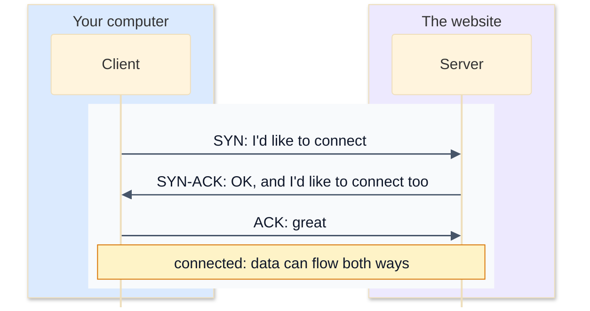
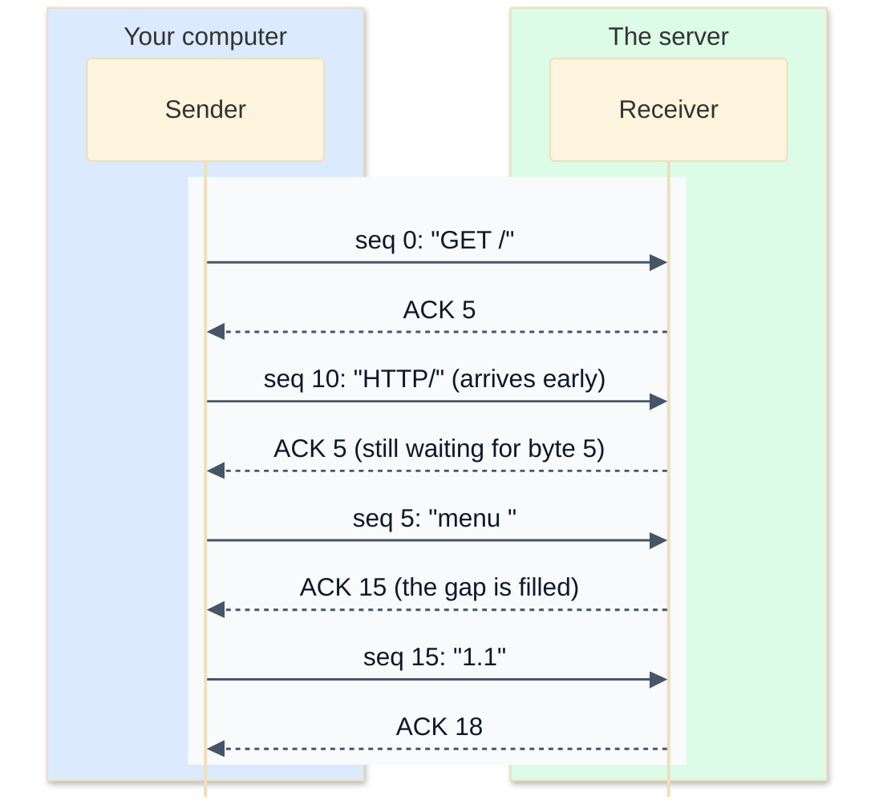

# 5. TCP and UDP

IP (lesson 2) gets packets from one computer to another, on a best-effort basis: packets can be lost, duplicated or arrive in the wrong order, and IP doesn't care. Programs need something more useful on top. There are two main choices, and nearly everything on the internet uses one of them:

- **TCP** (Transmission Control Protocol): a reliable stream of bytes, in order, with nothing missing. Used for web pages, email, file transfers and anything where every byte matters.
- **UDP** (User Datagram Protocol): send a message and hope. Fast and simple, with no guarantees. Used for DNS, video calls and online games.

## TCP: a reliable stream on an unreliable network

TCP's trick is to **number every byte**, and have the receiver report what it has received. If something goes missing, the sender sends it again.

### Opening a connection: the three-way handshake

Before any data flows, the two sides agree to talk, and each tells the other the number its bytes will start from:



That's one and a half round trips before the first byte of a web page can be sent, which is one reason a far-away server feels slow even on a fast connection.

### Sequence numbers and ACKs

Every **segment** (TCP's name for its packets) says which byte number its data starts at: its **sequence number**. After receiving, the other side sends an **ACK** (acknowledgement) with the number of the **next byte it expects**. The ACK is cumulative: "I've got everything before byte 15".

Here's a request of 18 bytes, `GET /menu HTTP/1.1`, sent in segments of 5 bytes, where the third segment arrives before the second:



The receiver holds on to the early segment until the gap before it is filled, then hands everything to the program in order. The program reading from the connection never sees any of this: it just gets `GET /menu HTTP/1.1`.

If the sender doesn't get an ACK for a segment in time, it assumes it was lost and sends it again: a **retransmission**. That can lead to duplicates, if the original was only slow, so the receiver simply ignores bytes it already has.

TCP does more besides. It slows down when the receiver can't keep up (**flow control**) or the network looks busy (**congestion control**), so one download doesn't swamp everyone else. And when either side is finished, it sends a **FIN** to close the connection cleanly.

## UDP: just send it

UDP has none of that. There's no handshake and no sequence numbers. Each message, called a **datagram**, is sent on its own. It might arrive, or not, and two datagrams might arrive in either order. UDP doesn't even tell you if one was lost.

Why would anyone want that? Because sometimes late is worse than lost:

- In a **video call**, if a bit of sound goes missing, it's better to skip it than to pause everyone while it's sent again.
- In an **online game**, the player's position from half a second ago is useless; the next update matters more.
- A **DNS** question and answer each fit in one small packet. Setting up a TCP connection first would take longer than the lookup itself. If no answer comes, the program just asks again.

| | TCP | UDP |
|---|---|---|
| Connection | opened with a handshake, closed with FIN | none: just send |
| Delivery | guaranteed, or you get an error | maybe |
| Order | always in order | any order |
| Duplicates | removed | possible |
| Speed | slower to start, extra round trips | as fast as it gets |
| Used for | the web (HTTP/1.1 and HTTP/2), email, SSH, file transfers | DNS, video and voice calls, games, live streaming |

One modern twist: **QUIC**, the protocol under HTTP/3, runs on UDP and does its own numbering and retransmission in the program instead of the operating system. That lets it start encrypted connections faster than TCP. Big sites like Google and YouTube already use it.

## Exercise: put the bytes back in order

Open [exercise.py](./exercise.py). It has the receiving side of a TCP connection, `Receiver`. Segments arrive as `(seq, data)`, where `seq` is the number of the first byte in `data`, counting from 0. They can arrive out of order, twice, or overlapping (a retransmission might not line up with the original).

`Receiver.__init__` sets up `next_expected` (the next byte number it's waiting for), `delivered` (the text handed to the program so far) and `_waiting` (early segments, held back). `waiting()` and `segments()` are written for you. Write:

| Method | What it does |
|---|---|
| `receive(seq, data)` | takes in a segment, delivers whatever can now be delivered in order, and returns the ACK: the number of the next byte expected |
| `_deliver_in_order()` | moves waiting segments that continue the delivered data into `delivered`, as many as possible. Throw away anything that's entirely old. |

The rules:

- Bytes are only ever added to `delivered` in order, with no gaps and nothing twice.
- A segment that's entirely before `next_expected` is an old duplicate: ignore it.
- A segment that overlaps `next_expected` delivers only its new part.
- The ACK never goes backwards.

Run the tests from the lesson folder:

```bash
cd 05-tcp-and-udp
python3 -m unittest -v
```

The last test sends 200 random messages with the segments shuffled and some sent twice, and checks every ACK along the way.

Running `python3 exercise.py` replays the example from the diagram, plus a duplicate. When everything works, it prints:

```
[(0, 'GET /'), (5, 'menu '), (10, 'HTTP/'), (15, '1.1')]
got seq  0 'GET /'  -> ACK  5  delivered so far: 'GET /'
got seq 10 'HTTP/'  -> ACK  5  delivered so far: 'GET /'
got seq  5 'menu '  -> ACK 15  delivered so far: 'GET /menu HTTP/'
got seq  5 'menu '  -> ACK 15  delivered so far: 'GET /menu HTTP/'
got seq 15 '1.1'    -> ACK 18  delivered so far: 'GET /menu HTTP/1.1'
```

<details>
<summary>Hints</summary>

- `receive`: if the segment ends after `next_expected` (`seq + len(data) > self.next_expected`), store it in `self._waiting[seq]`. Then call `self._deliver_in_order()` and return `self.next_expected`.
- `_deliver_in_order`: repeat until nothing changes. Look for a waiting segment whose `seq` is at or before `next_expected`. Remove it from `_waiting`. If it reaches past `next_expected`, add `data[self.next_expected - seq:]` to `delivered` and move `next_expected` to its end.

</details>

The full answer is in [solutions/05-tcp-and-udp.py](../solutions/05-tcp-and-udp.py).

## Recap

- TCP gives programs a reliable, ordered stream of bytes. It opens with a three-way handshake (SYN, SYN-ACK, ACK).
- Every byte is numbered. The receiver ACKs the next byte it expects; missing data is retransmitted; duplicates are dropped.
- UDP sends independent datagrams with no guarantees, which makes it faster and simpler.
- Use TCP when every byte matters, and UDP when speed matters more than the odd lost message.

Next: [6. Ports and sockets](../06-ports-and-sockets/)
