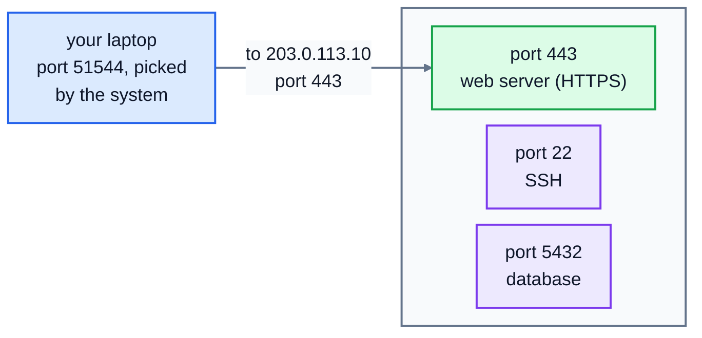

# 6. Ports and sockets

An IP address gets packets to the right computer. But a computer runs many network programs at once: a web browser, a chat app, maybe a database or a web server. **Ports** get the data to the right program. In this lesson you'll see how they work, and then write a real server and client in Python.

## Ports

A port is a number from 0 to 65535. A server program **listens** on a port, and clients connect to the computer's address plus that port. Think of the IP address as the street address of an office block, and the port as the number of the office inside.

One server, at `203.0.113.10`, running several programs, each listening on its own port:



Common services have standard port numbers, so clients know where to knock:

| Port | Service |
|---|---|
| 22 | SSH (logging in to another computer's terminal) |
| 25 | SMTP (servers sending email to each other) |
| 53 | DNS (UDP, and TCP for big answers) |
| 80 | HTTP |
| 443 | HTTPS (and HTTP/3 over UDP) |
| 3306 | MySQL |
| 5432 | PostgreSQL |

Ports below 1024 are **well-known ports**; on Linux and macOS, programs need special permission to listen on them. When you type `https://example.com`, the browser connects to port 443 because that's the standard. To use another port, put it in the address: `http://127.0.0.1:8000`.

The client needs a port too, for replies to come back to. The operating system picks a spare high-numbered one for it, called an **ephemeral port**. So every TCP connection is identified by four things: the client's address and port, and the server's address and port. That's how one web server on port 443 keeps thousands of visitors apart.

### Who's listening?

On Linux, `ss -tln` lists the programs listening for TCP connections (`-t` TCP, `-l` listening, `-n` numbers instead of names; use `-u` instead of `-t` for UDP). Here's a real run on a computer with three programs listening: one on 5432 (the usual PostgreSQL port) and two small web servers:

```
$ ss -tln
State  Recv-Q Send-Q Local Address:Port Peer Address:Port
LISTEN 0      128        127.0.0.1:5432      0.0.0.0:*
LISTEN 0      5          127.0.0.1:8000      0.0.0.0:*
LISTEN 0      5          127.0.0.1:8901      0.0.0.0:*
```

`127.0.0.1:8000` means "listening on port 8000, but only for connections from this computer". A server listening on `0.0.0.0` accepts connections on every network the computer is on, which is what a public server needs, and what you should be careful about on your own laptop. On macOS, use `lsof -i -P | grep LISTEN`; on Windows, `netstat -an`.

### When nobody's listening

If you connect to a port that nothing is listening on, the other computer replies straight away with a refusal, and the connection fails:

```
ConnectionRefusedError: [Errno 111] Connection refused
```

If instead nothing comes back at all, the connection just waits until it **times out**. That usually means a **firewall** is silently dropping the packets, or the computer is off. "Refused" and "timed out" point to different problems, so it's worth noticing which one you got.

## Sockets

Programs use the network through **sockets**: an object that represents one end of a connection. Almost every language has the same basic socket functions, because they all copy the original design from 1980s Unix. Python's `socket` module is a thin layer over them.

### A TCP server

```python
import socket

server = socket.socket(socket.AF_INET, socket.SOCK_STREAM)   # IPv4, TCP
server.bind(("127.0.0.1", 5050))                             # this address and port
server.listen()                                              # start waiting for clients

connection, client_address = server.accept()                 # wait for one to connect
data = connection.recv(1024)                                 # read up to 1024 bytes
connection.sendall(data.upper())                             # send a reply
connection.close()
```

- `AF_INET` means IPv4, and `SOCK_STREAM` means TCP. (`SOCK_DGRAM` is UDP.)
- `accept()` waits until a client connects, then returns a **new** socket just for that client. The original keeps listening for others.
- Sockets send and receive **bytes**, not text. Turn text into bytes with `.encode("utf-8")`, and back with `.decode("utf-8")`.

### A TCP client

```python
with socket.create_connection(("127.0.0.1", 5050), timeout=2) as connection:
    connection.sendall("two scones please".encode("utf-8"))
    connection.shutdown(socket.SHUT_WR)        # "I've finished sending"
    reply = connection.recv(1024)
```

`create_connection` does the TCP handshake from lesson 5. `shutdown(socket.SHUT_WR)` sends a FIN, telling the server that no more data is coming, while still letting the client read the reply.

### The thing everyone gets wrong: recv

TCP is a **stream** of bytes, not a series of messages. One `sendall` of 200,000 bytes might arrive as 40 separate `recv`s of different sizes, and two small `send`s might arrive in one `recv`. So `recv(1024)` means "give me **up to** 1024 bytes of whatever has arrived". To read a whole message, you must keep calling `recv` until you have it all.

The simplest way to know you have it all is for the sender to close its side: then `recv` returns `b""` (empty bytes), which means "the other end has finished".

```python
data = b""
while True:
    chunk = connection.recv(1024)
    if not chunk:          # b"" means the other side has finished sending
        break
    data += chunk
```

Real protocols use other ways to mark where a message ends. HTTP (lesson 7) uses a blank line after the headers and a `Content-Length` header for the body.

### UDP

UDP has no connections, so there's no `accept` or `connect`. You send a datagram to an address with `sendto`, and receive one with `recvfrom`, which also tells you who it came from:

```python
sock = socket.socket(socket.AF_INET, socket.SOCK_DGRAM)
sock.settimeout(1.0)
sock.sendto(b"ping", ("127.0.0.1", 5353))
try:
    data, sender = sock.recvfrom(65535)
except socket.timeout:
    data = None            # no reply: maybe it was lost, maybe nobody's there
```

Because UDP never confirms delivery, a timeout is the only way to give up waiting.

## Exercise: a shout server and its clients

Open [exercise.py](./exercise.py). It's a "shout server": it replies with whatever you send it, in capitals. `start_shout_server()` is written for you: it listens on `127.0.0.1` and handles each client in a background thread. Write:

| Function | What it does |
|---|---|
| `handle_client(connection)` | serves one client: read until the client stops sending, reply with the text in capitals, then close the connection |
| `tcp_request(host, port, text, timeout=2.0)` | connects, sends `text`, says it has finished sending, and returns everything the server sends back, as text |
| `udp_request(host, port, text, timeout=1.0)` | sends `text` in one datagram and returns the reply as text, or `None` if none arrives in time |
| `is_port_open(host, port, timeout=1.0)` | `True` if something is listening for TCP connections on that port. `sock.connect_ex(...)` returns `0` on success, instead of raising an error. |

Everything here talks only to `127.0.0.1`, your own computer. Run the tests from the lesson folder:

```bash
cd 06-ports-and-sockets
python3 -m unittest -v
```

Some tests send or receive 200,000 bytes, so a single `recv` won't do.

Running `python3 exercise.py` starts the server and tries each function. The port numbers will be different each time, because the server asks for any free port. When everything works, it prints something like:

```
Shout server listening on port 40293
IS THE BAKERY OPEN ON SUNDAY?
port 40293 open: True
port 60833 open: False
None
```

<details>
<summary>Hints</summary>

- `handle_client`: use `with connection:` so it's closed at the end. Read with the `recv` loop above, then `connection.sendall(data.decode("utf-8").upper().encode("utf-8"))`.
- `tcp_request`: the client code above, with the `recv` loop instead of a single `recv`.
- `udp_request`: the UDP code above. On Windows, a UDP reply from a closed port can show up as `ConnectionResetError`, so catch `(socket.timeout, ConnectionError)` and return `None` for both.
- `is_port_open`: make a TCP socket, set its timeout, and return `sock.connect_ex((host, port)) == 0`. Close the socket afterwards (`with` does it for you).

</details>

The full answer is in [solutions/06-ports-and-sockets.py](../solutions/06-ports-and-sockets.py).

## Recap

- **Ports** pick which program on a computer gets the data. Servers listen on standard ports, like 443 for HTTPS; clients get a random ephemeral port.
- A connection is identified by four things: both addresses and both ports.
- **Refused** means nothing is listening. **Timed out** usually means a firewall or a computer that's off.
- Sockets send bytes. TCP is a stream: keep calling `recv` until it returns `b""`.

Next: [7. HTTP](../07-http/)
