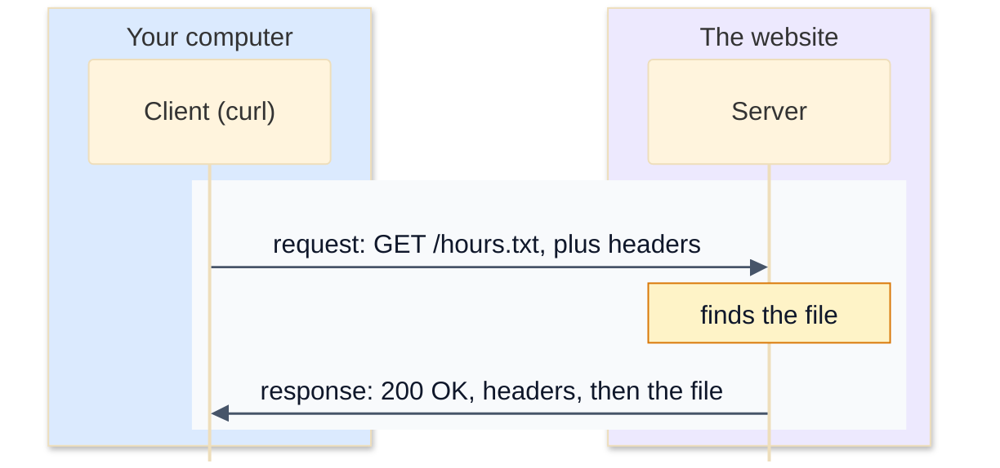

# 7. HTTP

**HTTP** (Hypertext Transfer Protocol) is the language of the web. Your browser speaks it to load pages, apps speak it to talk to their servers, and most of the services companies build are HTTP "APIs". The surprising thing about HTTP is how simple it is underneath: it's mostly plain text, and you can read it yourself.

## Requests and responses

HTTP is a conversation of **requests** and **responses**. The client sends a request; the server sends one response; that's one exchange.



Here's a real one, using `curl -v` (verbose) to fetch a small text file from a test web server on the same computer. Lines starting `>` are what curl sent; lines starting `<` are what came back:

```
$ curl -v --http1.1 http://127.0.0.1:8080/hours.txt
> GET /hours.txt HTTP/1.1
> Host: 127.0.0.1:8080
> User-Agent: curl/8.21.0
> Accept: */*
>
< HTTP/1.0 200 OK
< Server: SimpleHTTP/0.6 Python/3.14.7
< Date: Mon, 26 Oct 2026 04:53:46 GMT
< Content-type: text/plain
< Content-Length: 24
< Last-Modified: Mon, 26 Oct 2026 04:52:37 GMT
<
Open 9 to 4 on Sundays.
```

(The server here is Python's built-in `python3 -m http.server`, which answers in the older HTTP/1.0. The format is the same.)

### The request

```
GET /hours.txt HTTP/1.1          <- the request line: method, path, version
Host: 127.0.0.1:8080             <- headers, one per line: Name: value
User-Agent: curl/8.21.0
Accept: */*
                                 <- a blank line ends the headers
(the body, if there is one)
```

- The **method** says what you want to do (see below).
- The **path** is the part of the URL after the host: `/hours.txt`. It can include a **query string** after a `?`, like `/menu?day=sunday`.
- The **headers** add details. `Host` is required in HTTP/1.1, because one server often hosts many websites, and it needs to know which one you mean.
- Every line ends with `\r\n` (carriage return, line feed), a habit inherited from old teleprinters. A blank line, so `\r\n\r\n`, separates the headers from the body.

### The response

```
HTTP/1.0 200 OK                  <- the status line: version, status code, reason
Content-type: text/plain         <- headers
Content-Length: 24
                                 <- blank line
Open 9 to 4 on Sundays.          <- the body: exactly 24 bytes
```

`Content-Length` tells the client how many bytes of body to read, so it knows where the response ends. (The text is 23 characters plus a new-line character at the end, so 24 bytes.) It counts **bytes**, not characters: `é` is 2 bytes in UTF-8.

## Methods

| Method | Means | Example |
|---|---|---|
| `GET` | fetch something | load a page, get a list of orders |
| `POST` | send data to be processed, usually creating something | submit a form, place an order |
| `PUT` | replace something with this | update a whole profile |
| `PATCH` | change part of something | change just the delivery address |
| `DELETE` | remove something | cancel a booking |
| `HEAD` | like GET, but only send the headers | check whether a page exists |

`GET` requests shouldn't change anything on the server, so browsers and caches feel free to repeat them. That's why a form that places an order uses `POST`: refreshing the page makes the browser warn you before sending it again.

## Status codes

The first digit of the status code tells you the kind of answer:

| Code | Class | Common examples |
|---|---|---|
| 1xx | informational | `101 Switching Protocols` |
| 2xx | **success** | `200 OK`, `201 Created`, `204 No Content` |
| 3xx | **redirect**: look somewhere else | `301 Moved Permanently`, `302 Found`, `304 Not Modified` |
| 4xx | **client error**: the request was wrong | `400 Bad Request`, `401 Unauthorized`, `403 Forbidden`, `404 Not Found`, `429 Too Many Requests` |
| 5xx | **server error**: the server failed | `500 Internal Server Error`, `502 Bad Gateway`, `503 Service Unavailable` |

The difference between 4xx and 5xx matters when something goes wrong: 4xx means "fix your request", 5xx means "it's not you, it's them". A redirect response has a `Location` header saying where to go, and clients like browsers follow it automatically.

## Headers worth knowing

| Header | In | Means |
|---|---|---|
| `Host` | request | which website on this server |
| `User-Agent` | request | which program is asking |
| `Accept` | request | what kinds of content the client wants |
| `Cookie` | request | data the server asked the browser to store, sent back each time |
| `Content-Type` | both | what the body is: `text/html`, `application/json`, `image/png` |
| `Content-Length` | both | the size of the body, in bytes |
| `Location` | response | where a redirect points |
| `Set-Cookie` | response | asks the browser to store a cookie |
| `Cache-Control` | response | how long the response can be cached |

Header names aren't case-sensitive: `Content-Type` and `content-type` are the same header. HTTP/2 writes them all in lower case.

### HTTP has no memory

Each request stands alone. The server doesn't remember that you logged in a moment ago. **Cookies** are how websites get around that: after you log in, the response includes `Set-Cookie: session=...`, and your browser sends `Cookie: session=...` with every later request, so the server can tell it's you.

## HTTP versions

- **HTTP/1.1** (1997) is the text format above. It's still everywhere and it's what you'll write in the exercise.
- **HTTP/2** (2015) sends the same requests and responses in a compact binary form, and lets many of them share one connection at once. curl shows it with lower-case headers:

  ```
  $ curl -v https://example.com
  > GET / HTTP/2
  > Host: example.com
  > User-Agent: curl/8.21.0
  > Accept: */*
  >
  < HTTP/2 200
  < date: Mon, 26 Oct 2026 04:44:24 GMT
  < content-type: text/html; charset=utf-8
  < server: cloudflare
  < last-modified: Sat, 24 Oct 2026 20:05:47 GMT
  < allow: GET, HEAD
  < accept-ranges: bytes
  < age: 2592
  < cf-cache-status: HIT
  ```

  (Two Cloudflare-specific headers are left out.)
- **HTTP/3** (2022) runs over QUIC, on UDP (lesson 5).

The methods, paths, headers and status codes are the same in all three. Only the way they're packed for the trip changes.

## Exercise: read and write HTTP

Open [exercise.py](./exercise.py). `split_head(message)` is written for you: it splits a message at the first blank line into a list of head lines and the body. Write:

| Function | What it does |
|---|---|
| `parse_headers(lines)` | turns lines like `Content-Type: text/html` into a dict with **lower-case** names: `{"content-type": "text/html"}`. Split at the first colon only, because values can contain colons. |
| `parse_request(raw)` | returns a dict with `method`, `path`, `query` (the part after `?`, or `""`), `version`, `headers` and `body` |
| `parse_response(raw)` | returns a dict with `version`, `status` (as an `int`), `reason`, `headers` and `body` |
| `build_response(status, body="", content_type="text/plain; charset=utf-8")` | builds a complete HTTP/1.1 response, with `Content-Type` and a correct `Content-Length`, as text |
| `status_class(status)` | `"informational"`, `"success"`, `"redirect"`, `"client error"` or `"server error"` |

For `build_response`, the reason phrase comes from Python's `http.HTTPStatus`: `HTTPStatus(404).phrase` is `'Not Found'`.

Run the tests from the lesson folder:

```bash
cd 07-http
python3 -m unittest -v
```

Some tests use real HTTP clients from Python's standard library. One sends a real request to a test server, and checks that your `parse_request` reads it correctly. Another serves your `build_response` output and checks that `urllib` can understand it.

Running `python3 exercise.py` parses a request and builds a response. When everything works, it prints:

```
{'method': 'GET', 'path': '/menu', 'query': 'day=sunday', 'version': 'HTTP/1.1', 'headers': {'host': 'rosiesbakery.example', 'user-agent': 'curl/8.11.0', 'accept': '*/*'}, 'body': ''}
HTTP/1.1 200 OK\r\n
Content-Type: text/plain; charset=utf-8\r\n
Content-Length: 23\r\n
\r\n
Open 9 to 4 on Sundays.
200 client error server error
```

<details>
<summary>Hints</summary>

- `parse_headers`: `name, _, value = line.partition(":")` splits at the first colon. Then `name.strip().lower()` and `value.strip()`.
- `parse_request`: the first line splits into three with `.split(" ")`. `target.partition("?")` separates the path from the query.
- `parse_response`: the reason can contain spaces, so use `.split(" ", 2)` to split into at most three parts.
- `build_response`: `len(body.encode("utf-8"))` gives the length in bytes. Join the lines with `"\r\n"`, and don't forget the blank line before the body.
- `status_class`: `status // 100` gives the first digit.

</details>

The full answer is in [solutions/07-http.py](../solutions/07-http.py).

## Recap

- HTTP is requests and responses. A request has a method, path and headers; a response has a status code, headers and a body.
- A blank line separates the headers from the body. `Content-Length` says how long the body is, in bytes.
- 2xx is success, 3xx a redirect, 4xx a problem with the request, and 5xx a problem on the server.
- HTTP is stateless; cookies let a server recognise you between requests.

Next: [8. HTTPS and TLS](../08-https-and-tls/)
