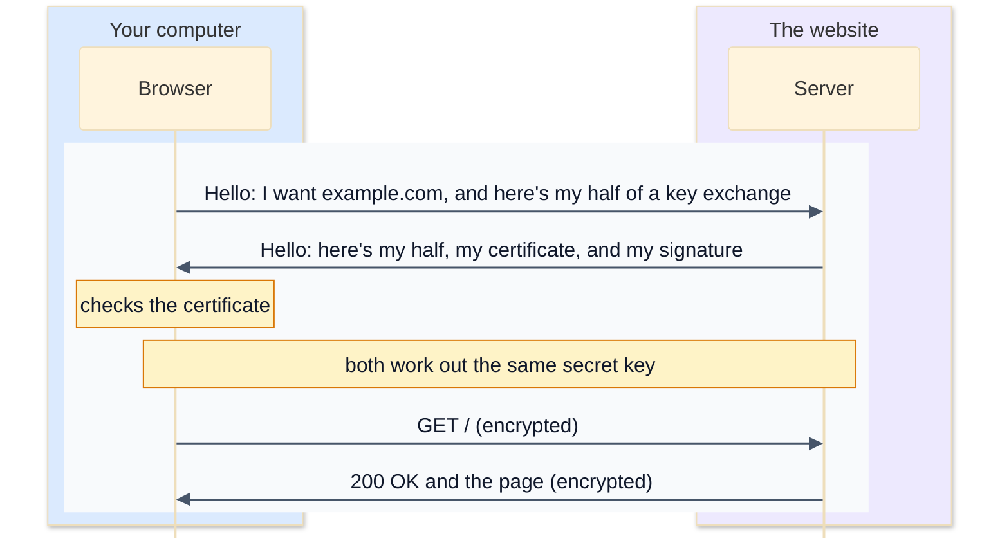

# 8. HTTPS and TLS

Plain HTTP (lesson 7) is readable text, and it passes through a lot of hands on its way: the café's Wi-Fi, your internet provider, and every router in between. Any of them could read your password, or change the page you get back. **HTTPS** is HTTP sent through an encrypted connection made by **TLS** (Transport Layer Security). Today almost every website uses it.

## What TLS gives you

| Guarantee | Means | Without it |
|---|---|---|
| **Privacy** | nobody in the middle can read what's sent | anyone on the same Wi-Fi could read your passwords |
| **Integrity** | nobody can change it on the way without being noticed | a network could insert adverts or malware into pages |
| **Authentication** | you're really talking to the site you asked for | a fake Wi-Fi hotspot could pretend to be your bank |

The first two come from encryption. The third, which is just as important, comes from **certificates**.

## Two kinds of encryption

TLS uses two kinds of encryption together:

- **Symmetric** encryption uses one secret key to encrypt and decrypt. It's very fast, but both sides need the same key, and you can't just send it across the network, where anyone could copy it.
- **Public-key** encryption uses a pair of keys: a **public key**, which anyone may have, and a **private key**, which its owner keeps secret. What one key encrypts, only the other can decrypt. It also lets the owner **sign** data with the private key, in a way anyone can check with the public key. It's slow, but it solves the problem of agreeing on a key with a stranger.

So TLS uses public-key methods at the start of a connection, to check who the server is and to agree on a fresh symmetric key, and then uses that fast symmetric key for everything after.

## The handshake

When your browser connects to `https://example.com`, on port 443, the TCP connection (lesson 5) is followed by a TLS handshake. Simplified, for TLS 1.3, the current version:



The two "halves" let each side calculate the same secret key without it ever being sent (this is called a Diffie-Hellman key exchange). The server's signature, made with its private key, proves that it owns the certificate it sent. And the whole thing takes just one round trip.

## Certificates

A **certificate** is a small document that says, in effect, "the public key in here belongs to example.com", signed by an organisation your computer trusts, called a **certificate authority** (CA). Here's the real certificate example.com sent, as Python's `ssl` module shows it:

```python
>>> import socket, ssl
>>> context = ssl.create_default_context()
>>> with socket.create_connection(("example.com", 443)) as sock:
...     with context.wrap_socket(sock, server_hostname="example.com") as tls:
...         print(tls.version())
...         cert = tls.getpeercert()
...
TLSv1.3
>>> cert["subject"]
((('commonName', 'example.com'),),)
>>> cert["issuer"]
((('countryName', 'US'),), (('organizationName', 'SSL Corporation'),), (('commonName', 'Cloudflare TLS Issuing ECC CA 3'),))
>>> cert["notBefore"], cert["notAfter"]
('Sep 26 22:49:11 2026 GMT', 'Dec 25 22:56:35 2026 GMT')
>>> cert["subjectAltName"]
(('DNS', 'example.com'), ('DNS', '*.example.com'))
```

- **subject**: who the certificate is for.
- **issuer**: the CA that signed it.
- **notBefore** and **notAfter**: the dates it's valid between. This one lasts about three months; many CAs now issue short-lived certificates and renew them automatically.
- **subjectAltName** (SAN): the host names it covers. This is the list that's actually checked. `*.example.com` is a **wildcard**: it covers `www.example.com` or `shop.example.com`, but not `example.com` itself, and not `a.b.example.com`.

### The chain of trust

Your computer doesn't know "Cloudflare TLS Issuing ECC CA 3" personally. So the server sends a **chain**: its own certificate, signed by an intermediate CA, whose certificate is signed by another, and so on up to a **root CA** that's built into your operating system or browser. The `openssl` command shows it:

```
$ openssl s_client -connect example.com:443 -servername example.com
Certificate chain
 0 s:CN=example.com
   i:C=US, O=SSL Corporation, CN=Cloudflare TLS Issuing ECC CA 3
 1 s:C=US, O=SSL Corporation, CN=Cloudflare TLS Issuing ECC CA 3
   i:C=US, O=SSL Corporation, CN=SSL.com TLS Transit ECC CA R2
 2 s:C=US, O=SSL Corporation, CN=SSL.com TLS Transit ECC CA R2
   ...
```

(Shortened.) `s:` is each certificate's subject and `i:` its issuer. Each one is signed by the next, up to a root your computer already trusts. Your computer comes with about 150 trusted roots. **Let's Encrypt** is a free, non-profit CA that made HTTPS free for everyone, and now issues a large share of the web's certificates.

### What the browser checks

Before trusting the connection, the browser checks:

1. The chain leads to a trusted root, and every signature in it is valid.
2. Today's date is between `notBefore` and `notAfter`.
3. The host name you asked for matches one of the certificate's names.

If any check fails, you get a full-page warning like "Your connection is not private". The most common real-world cause is boring: someone forgot to renew a certificate, and it expired.

## What HTTPS doesn't hide

HTTPS encrypts the content: the path, the headers, cookies and the page. But some things are still visible to the network:

- the server's **IP address**, and roughly how much data you send and receive, and when
- the **name of the site**, in most cases: the browser's first "hello" includes it (this is called **SNI**), so a server hosting many sites knows which certificate to send. Newer "encrypted client hello" technology is starting to hide that too.
- your **DNS lookups**, unless you use encrypted DNS

So HTTPS stops people reading your password or your messages, but your network can still see that you visited `example.com`.

## Exercise: check a certificate like a browser does

Open [exercise.py](./exercise.py). `EXAMPLE_CERT` is the real certificate from above, as a dictionary. Write these functions. Times are seconds since 1970; `ssl.cert_time_to_seconds("Dec 25 22:56:35 2026 GMT")` turns a certificate date into that form.

| Function | What it does |
|---|---|
| `dns_names(cert)` | the host names in the certificate's `subjectAltName`: only the `'DNS'` entries, in order |
| `issuer_name(cert)` | the issuer's `commonName`, like `'Cloudflare TLS Issuing ECC CA 3'` |
| `hostname_matches(pattern, hostname)` | whether a certificate name covers a host name. Case doesn't matter. A `*` must be the whole first label and stands for exactly one label. |
| `days_left(cert, now)` | whole days until `notAfter`: negative if it has already expired |
| `certificate_problems(cert, hostname, now)` | a list of problems, in this order: `'not valid yet'`, `'expired'`, `'wrong host name'`. An empty list means it's fine. |

The real checks also verify the signatures in the chain, which needs cryptography beyond this course; Python's `ssl` module does all of it for you whenever you connect.

Run the tests from the lesson folder:

```bash
cd 08-https-and-tls
python3 -m unittest -v
```

Running `python3 exercise.py` checks the example certificate against a few host names, pretending today is 26 October 2026, and then pretending it's January 2027. When everything works, it prints:

```
['example.com', '*.example.com'] Cloudflare TLS Issuing ECC CA 3
60
example.com []
www.example.com []
shop.www.example.com ['wrong host name']
example.org ['wrong host name']
['expired']
```

<details>
<summary>Hints</summary>

- `dns_names`: `cert.get("subjectAltName", ())` is a tuple of `(kind, value)` pairs.
- `issuer_name`: `cert["issuer"]` is a tuple of parts, and each part is a tuple of `(key, value)` pairs. Loop over both levels.
- `hostname_matches`: lower-case both. Without `*.`, they must be equal. With it, split the host name at its first dot: `first, _, rest = hostname.partition(".")`. It matches if `first` isn't empty and `rest` equals the pattern without its `*.`.
- `days_left`: `(ssl.cert_time_to_seconds(cert["notAfter"]) - now) // DAY`, as an `int`.

</details>

The full answer is in [solutions/08-https-and-tls.py](../solutions/08-https-and-tls.py).

## Recap

- HTTPS is HTTP inside TLS, which gives privacy, integrity and authentication.
- Public-key cryptography sets up the connection; a shared symmetric key encrypts the data.
- A certificate binds a public key to host names, signed by a CA, with a chain up to a trusted root.
- Browsers check the chain, the dates and the host name. Expired certificates are the most common failure.

Next: [9. Network tools](../09-network-tools/)
