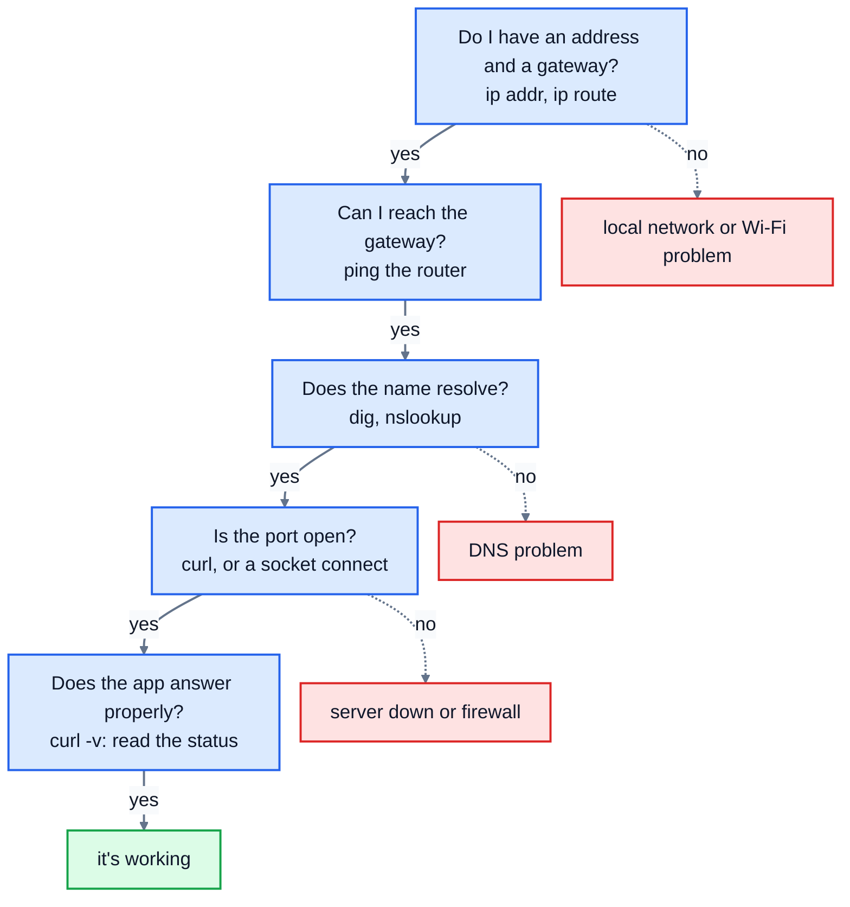

# 9. Network tools

"The website's down" could mean a dozen different things: your Wi-Fi, your router, DNS, a firewall, the server, or the web app on it. A handful of command-line tools let you test each layer in turn and find out which. This lesson tours them, with real output, and then you'll write Python that reads their output, the way monitoring scripts do.

## ping: can I reach it?

`ping` sends small "echo request" packets (using a protocol called ICMP) and times the replies:

```
$ ping -c 4 example.com
PING example.com (172.66.147.243) 56(84) bytes of data.
64 bytes from 172.66.147.243: icmp_seq=1 ttl=64 time=4.98 ms
64 bytes from 172.66.147.243: icmp_seq=2 ttl=64 time=9.54 ms
64 bytes from 172.66.147.243: icmp_seq=3 ttl=64 time=8.11 ms
64 bytes from 172.66.147.243: icmp_seq=4 ttl=64 time=9.60 ms

--- example.com ping statistics ---
4 packets transmitted, 4 received, 0% packet loss, time 3005ms
rtt min/avg/max/mdev = 4.980/8.055/9.596/1.873 ms
```

- The first line shows that the name was turned into an address, so DNS works.
- `time=` is the **round-trip time**: there and back, in milliseconds. Across a city it's a few ms; across an ocean, 70 to 150 ms.
- The summary gives the **packet loss** and the minimum, average and maximum times. `mdev` is how much the times vary, which matters for video calls.
- `-c 4` stops after 4 pings. Without it, Linux and macOS ping until you press Ctrl+C; Windows sends 4 by default.

Here's a ping that gets no replies, to `192.0.2.1`, an address used only in documentation:

```
$ ping -c 3 -W 1 192.0.2.1
PING 192.0.2.1 (192.0.2.1) 56(84) bytes of data.

--- 192.0.2.1 ping statistics ---
3 packets transmitted, 0 received, 100% packet loss, time 2040ms
```

Careful: no reply doesn't always mean the computer is down. Many servers and firewalls ignore pings on purpose. A website can work perfectly while ping says 100% loss.

## traceroute: which way do packets go?

`traceroute` (`tracert` on Windows) lists the routers along the path, by sending packets that are designed to expire after 1 hop, then 2, then 3, and noting who reports each one. Lesson 1 showed a real run in which every hop after the first answered `*`, because many networks don't reply. When it does work, it's useful for seeing *where* along the path things slow down or stop.

## dig and nslookup: does DNS work?

```
$ dig @1.1.1.1 example.com
...
;; ANSWER SECTION:
example.com.		52	IN	A	172.66.147.243
example.com.		52	IN	A	104.20.23.154

;; Query time: 23 msec
;; SERVER: 1.1.1.1#53(1.1.1.1) (UDP)
```

Lesson 4 explains the answer. Two handy options: `+short` prints only the values, and `+noall +answer` prints only the answer lines. Asking a public resolver with `@1.1.1.1` and getting an answer, when your normal lookups fail, points to a problem with your own DNS settings. `nslookup example.com` works on every system, including Windows.

## curl: does the web server answer?

`curl` makes HTTP requests from the terminal. Lesson 7 used `curl -v` to show the whole conversation. A few more ways to use it:

```
$ curl -I https://example.com/no-such-page
HTTP/2 404
...
$ curl -s -o /dev/null -w "%{http_code} %{time_total}\n" https://example.com
200 0.191683
```

- `-I` asks for the headers only (a `HEAD` request).
- `-s -o /dev/null -w "..."` throws the page away and prints just the status code and the total time in seconds: a one-line health check.

If `ping` and `dig` work but `curl` fails, the problem is the web server or something in front of it, not the network.

## ss: what's listening here?

On the server itself, `ss -tln` (lesson 6) shows which ports have a program listening:

```
$ ss -tln
State  Recv-Q Send-Q Local Address:Port Peer Address:Port
LISTEN 0      128        127.0.0.1:5432      0.0.0.0:*
LISTEN 0      5          127.0.0.1:8000      0.0.0.0:*
LISTEN 0      5          127.0.0.1:8901      0.0.0.0:*
```

If the web server should be on port 443 and it's not in the list, it isn't running. If it's listening on `127.0.0.1` only, other computers can't reach it, which is a very common mistake when setting up a server.

## ip: my own address and routes

`ip -br addr` shows your addresses, and `ip route` shows the default gateway (lesson 3). macOS uses `ifconfig` and `netstat -rn`; Windows has `ipconfig` and `route print`.

## The same tools on other systems

| Job | Linux | macOS | Windows |
|---|---|---|---|
| reachability | `ping` | `ping` | `ping` |
| path | `traceroute` | `traceroute` | `tracert` |
| DNS | `dig`, `nslookup` | `dig`, `nslookup` | `nslookup`, `Resolve-DnsName` |
| HTTP | `curl` | `curl` | `curl` (built in since Windows 10) |
| listening ports | `ss -tln` | `lsof -i -P` | `netstat -an` |
| addresses, routes | `ip addr`, `ip route` | `ifconfig`, `netstat -rn` | `ipconfig`, `route print` |

## Working up the layers

When something doesn't work, test each layer from the bottom, and stop at the first one that fails:



## Exercise: read the tools' output

Monitoring scripts often run these tools and read their output. The [samples](./samples/) folder has the real outputs shown above. Open [exercise.py](./exercise.py) and write:

| Function | What it does |
|---|---|
| `parse_ping(text)` | reads the summary of Linux `ping` output and returns a dict: `sent`, `received`, `loss_percent` (a float), and `min_ms`, `avg_ms`, `max_ms` (floats, or `None` if no replies came back) |
| `parse_dig(text)` | returns the answer records as `(name, ttl, type, value)` tuples, with the final dots removed from names and values. It must work on full `dig` output (read the lines after `;; ANSWER SECTION:`, up to the next blank line) and on `+noall +answer` output (every non-empty line is an answer). |
| `listening_ports(text)` | returns a sorted list of the port numbers in `ss -tln` output, each once |

Run the tests from the lesson folder:

```bash
cd 09-network-tools
python3 -m unittest -v
```

Running `python3 exercise.py` reads each sample. When everything works, it prints:

```
{'sent': 4, 'received': 4, 'loss_percent': 0.0, 'min_ms': 4.98, 'avg_ms': 8.055, 'max_ms': 9.596}
{'sent': 3, 'received': 0, 'loss_percent': 100.0, 'min_ms': None, 'avg_ms': None, 'max_ms': None}
[('example.com', 52, 'A', '172.66.147.243'), ('example.com', 52, 'A', '104.20.23.154')]
[('www.github.com', 3600, 'CNAME', 'github.com'), ('github.com', 60, 'A', '20.207.73.82')]
[5432, 8000, 8901]
```

<details>
<summary>Hints</summary>

- `parse_ping`: regular expressions (the `re` module) make this easy. `re.search(r"(\d+) packets transmitted, (\d+) received, ([\d.]+)% packet loss", text)` finds the counts; `match.group(1)` is the first number. A second search for `= ([\d.]+)/([\d.]+)/([\d.]+)/` finds the times, if there's an `rtt` line.
- `parse_dig`: if `";; ANSWER SECTION:"` is one of the lines, start just after it. Skip lines starting with `;`, and stop at a blank line once you've found some answers. `line.split(None, 4)` splits on any whitespace into at most 5 parts, so an MX value like `10 mail.example.` stays together.
- `listening_ports`: skip the header line. The fourth column is the local address and port; the port is after the **last** colon (`rsplit(":", 1)`), because IPv6 addresses like `[::1]:8080` contain colons too. Collect them in a set.

</details>

The full answer is in [solutions/09-network-tools.py](../solutions/09-network-tools.py).

## Recap

- `ping` tests reachability and round-trip time, but many servers ignore it.
- `traceroute` shows the path; `dig` and `nslookup` test DNS; `curl` tests the web server; `ss` shows what's listening.
- Troubleshoot from the bottom layer up, and stop at the first test that fails.

Next: [10. Project: uptime checker](../10-project-uptime-checker/)
